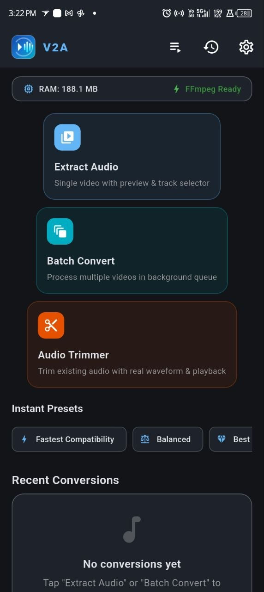
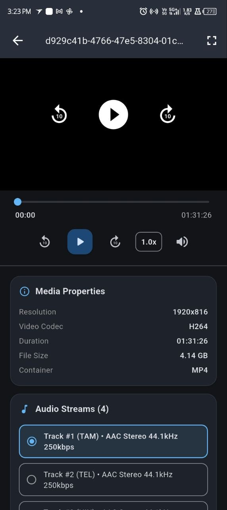
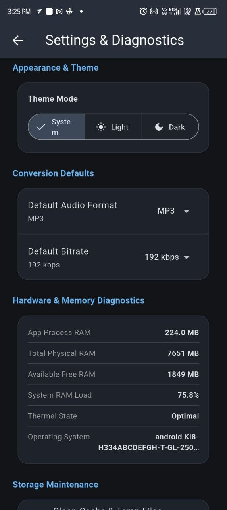
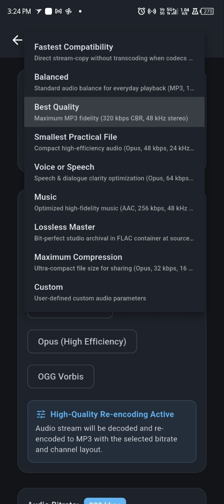
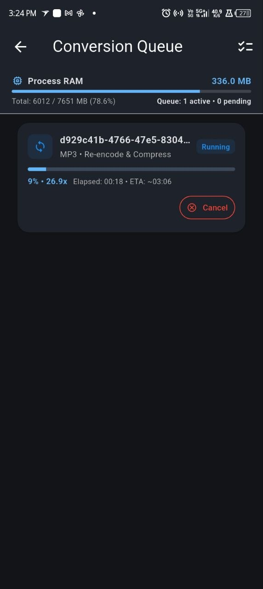
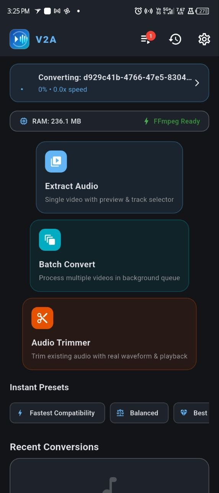

# V2A — Video-to-Audio Converter & Studio (Android & Desktop)

<p align="center">
  
</p>

<p align="center">
  <b>Extract, convert, trim and manage audio from video files — on Windows 10/11, macOS, Linux, and Android.</b><br>
  V2A is a high-performance native media suite built with Flutter and streaming FFmpeg. It provides professional video-to-audio extraction, batch audio format transcoding, multi-stream track routing (MKV/MP4), video preview, audio playback, background queue processing, and precision waveform trimming across mobile and desktop platforms.
</p>

<p align="center">
  <a href="https://github.com/margacis2/v2a/releases/tag/v1.2.2"></a>
  
  
  
  <a href="LICENSE"></a>
  
  
</p>

---

## 📦 Official Release Downloads (Version 1.2.2)

All production binaries are uploaded and directly downloadable from the official [V2A v1.2.2 GitHub Release](https://github.com/margacis2/v2a/releases/tag/v1.2.2):

### 🪟 Windows 10 / 11 (64-bit)
| Package Format | File Name | Size | Direct Download Link |
|---|---|---|---|
| **Inno Setup EXE Installer** | `V2A-Setup-1.2.2-x64.exe` | 41.7 MB | [Direct Download](https://github.com/margacis2/v2a/releases/download/v1.2.2/V2A-Setup-1.2.2-x64.exe) |
| **Windows MSI Installer** | `V2A-1.2.2-x64.msi` | 42.1 MB | [Direct Download](https://github.com/margacis2/v2a/releases/download/v1.2.2/V2A-1.2.2-x64.msi) |
| **Standalone Portable ZIP** | `V2A-1.2.2-Windows-x64-Portable.zip` | 58.0 MB | [Direct Download](https://github.com/margacis2/v2a/releases/download/v1.2.2/V2A-1.2.2-Windows-x64-Portable.zip) |

### 🍏 macOS (Apple Silicon & Intel Universal 2)
| Package Format | File Name | Size | Direct Download Link |
|---|---|---|---|
| **Apple Disk Image (DMG)** | `V2A-1.2.2-macOS.dmg` | 63.2 MB | [Direct Download](https://github.com/margacis2/v2a/releases/download/v1.2.2/V2A-1.2.2-macOS.dmg) |
| **Component Package (PKG)** | `V2A-1.2.2-macOS.pkg` | 56.7 MB | [Direct Download](https://github.com/margacis2/v2a/releases/download/v1.2.2/V2A-1.2.2-macOS.pkg) |

### 🐧 Linux (x86_64)
| Distribution / Package Format | File Name | Size | Direct Download Link |
|---|---|---|---|
| **Debian / Ubuntu (.deb)** | `V2A-1.2.2-Linux-x64.deb` | 17.1 MB | [Direct Download](https://github.com/margacis2/v2a/releases/download/v1.2.2/V2A-1.2.2-Linux-x64.deb) |
| **Fedora / RHEL (.rpm)** | `V2A-1.2.2-Linux-x64.rpm` | 17.1 MB | [Direct Download](https://github.com/margacis2/v2a/releases/download/v1.2.2/V2A-1.2.2-Linux-x64.rpm) |
| **Universal AppImage** | `V2A-1.2.2-x86_64.AppImage` | 20.0 MB | [Direct Download](https://github.com/margacis2/v2a/releases/download/v1.2.2/V2A-1.2.2-x86_64.AppImage) |
| **Portable Tarball (.tar.gz)** | `V2A-1.2.2-Linux-x64-Portable.tar.gz` | 20.6 MB | [Direct Download](https://github.com/margacis2/v2a/releases/download/v1.2.2/V2A-1.2.2-Linux-x64-Portable.tar.gz) |

### 🤖 Android (APKs & Google Play Bundle)
| Target Device / Architecture | Package Name | Size | Direct Download Link |
|---|---|---|---|
| **ARM64 Devices (Recommended)** | `V2A-arm64-v8a-release.apk` | 63.9 MB | [Direct Download](https://github.com/margacis2/v2a/releases/download/v1.2.2/V2A-arm64-v8a-release.apk) |
| **Older 32-bit ARM Devices** | `V2A-armeabi-v7a-release.apk` | 98.0 MB | [Direct Download](https://github.com/margacis2/v2a/releases/download/v1.2.2/V2A-armeabi-v7a-release.apk) |
| **x86_64 Emulators / ChromeOS** | `V2A-x86_64-release.apk` | 71.5 MB | [Direct Download](https://github.com/margacis2/v2a/releases/download/v1.2.2/V2A-x86_64-release.apk) |
| **Universal All-in-One APK** | `V2A-universal-release.apk` | 229.4 MB | [Direct Download](https://github.com/margacis2/v2a/releases/download/v1.2.2/V2A-universal-release.apk) |
| **Google Play App Bundle** | `V2A-release.aab` | 142.8 MB | [Direct Download](https://github.com/margacis2/v2a/releases/download/v1.2.2/V2A-release.aab) |

---

## 📸 Screenshots

Here are screenshots of the **V2A** application running on Android:

| Home Screen | Video Preview | Conversion Settings |
|:---:|:---:|:---:|
|  |  |  |

| Preset Selection | Conversion Queue | Background Processing |
|:---:|:---:|:---:|
|  |  |  |

---

## ✨ Key Features

### 1. Multi-Stream Audio Track Extraction (MKV, MP4, WebM)
- **Container Stream Enumeration**: Uses FFprobe to inspect all audio tracks in a container, displaying stream index, language, codec, channel layout (Mono, Stereo, 5.1, 7.1), sample rate, and default flags.
- **Selective & Batch Extraction**: Extract individual tracks or convert **all audio tracks simultaneously** into separate labeled files (`movie_Track1_eng.mp3`, `movie_Track2_tam.mp3`).
- **Dynamic FFmpeg Stream Mapping**: Automatically passes `-map 0:a:N` parameters for clean extraction without video re-encoding overhead.

### 2. Audio Extraction and Conversion

#### Fastest Compatible Mode
- Uses direct FFmpeg packet stream copying (`-c:a copy`) when the source audio codec matches the chosen output container (e.g. AAC to M4A, Opus to Opus/OGG, MP3 to MP3).
- Avoids unnecessary audio re-encoding, achieving speeds of 20× to 80× real-time with 0% CPU transcoding overhead.
- Preserves the original bit-perfect encoded audio stream with zero quality loss.

#### Audio Re-encoding
- **Bitrates**: Configurable audio bitrates from 16 kbps to 320 kbps, plus custom bitrate input.
- **Bitrate Modes**: Constant Bitrate (CBR) and Variable Bitrate (VBR) where supported by the selected encoder.
- **Sample Rates**: 8.0 kHz, 11.025 kHz, 16.0 kHz, 22.05 kHz, 24.0 kHz, 32.0 kHz, 44.1 kHz, 48.0 kHz, 88.2 kHz, 96.0 kHz, and 192.0 kHz.
- **Channel Layouts**: Keep Original, Mono (1 ch), Stereo (2 ch), 2.1 Surround (3 ch), 4.0 Quadraphonic (4 ch), 5.1 Surround (6 ch), and 7.1 Surround (8 ch).

#### Audio Processing & Enhancement
- **Decibel Volume Adjustment**: Precision slider and numeric input from -24 dB to +24 dB with a one-click reset to 0 dB (`volume=XdB`).
- **Loudness Normalization**: Integrated EBU R128 (`loudnorm=I=-16:TP=-1.5:LRA=11`) broadcast loudness normalization.
- **Silence Trimming**: Automatic lead and trailing silence detection and removal (`silenceremove`).
- **Fade Effects**: Configurable smooth fade-in and fade-out transitions.

#### Metadata & Album Artwork
- Full ID3v2, Vorbis, and container tag editing: Title, Artist, Album, Album Artist, Year, Genre, Track Number, Disc Number, Composer, Copyright, Comment, Lyrics, and Language.
- Option to strip all metadata (`-map_metadata -1`) or preserve original tags.
- Front cover album artwork embedding (`attached_pic`).

#### Lossless Export
- Uncompressed 16-bit linear PCM WAV.
- Bit-perfect FLAC lossless compression (level 5).
- Clear warning banner when converting lossy audio sources into lossless containers, clarifying that transcoding cannot restore previously discarded audio frequencies.

---

## ⚡ 3. Eight Built-in Conversion Presets

| Preset | Target Format | Bitrate | Sample Rate | Channels | Description |
|---|---|---|---|---|---|
| **Fastest Compatibility** | Passthrough / AAC fallback | Source / 192 kbps | Source / Configured | Original / Stereo | Direct stream-copy without transcoding; instant & zero quality loss |
| **Balanced** | MP3 | 192 kbps | 44.1 kHz | Stereo | Standard everyday audio balance for universal playback |
| **Best Quality** | MP3 | 320 kbps | 48.0 kHz | Stereo | Maximum MP3 fidelity with studio sample rate |
| **Smallest Practical File** | Opus | 48 kbps | 24.0 kHz | Mono | Ultra-efficient compact storage for podcasts and audiobooks |
| **Voice or Speech** | Opus | 64 kbps | 24.0 kHz | Mono | Speech & dialogue clarity optimization for vocal clarity |
| **Music** | AAC | 256 kbps | 48.0 kHz | Stereo | High-fidelity Apple AAC for music preservation |
| **Lossless Master** | FLAC | Lossless | Source | Original | Bit-perfect studio archival at native source sample rate |
| **Maximum Compression** | Opus | 32 kbps | 16.0 kHz | Mono | Minimum file size for messaging and low-bandwidth sharing |

*Actual output parameters depend on source media compatibility and the selected conversion mode.*

---

## ✂️ 4. Standalone Audio Trimmer

- Accessible directly from the Home screen.
- High-speed downsampled PCM waveform visualization generated using FFmpeg.
- Precise start and end timestamp controls with sub-second accuracy.
- Quick-adjustment nudge chips: `±1 second`, `±5 seconds`, and `±1 minute`.
- Non-destructive atomic export with collision-free naming.

---

## 🛡️ 5. Duplicate-Safe File Management

V2A protects existing files from accidental overwriting. For example:
```text
Audio.mp3  ──>  Audio (1).mp3  ──>  Audio (2).mp3
```

Additional safety mechanisms:
- **Strict Destination Enforcement**: Choose between the configured default directory, saving beside the original source file, or choosing any custom folder.
- **Automatic Duplicate Resolution**: Automatically increments filename index on collision.
- **Atomic Staging Files**: Temporary processing files (`.tmp_*`) are staged and integrity-verified before moving to the destination folder.
- **Storage Pre-flight Check**: Verifies free storage space before starting a conversion.

---

## 🎵 6. Built-in Audio Player

- **Broad Codec Support**: MP3, AAC, M4A, WAV, FLAC, OGG, and Opus playback.
- **Background Playback**: Continuous background audio playback with foreground notification controls via `just_audio` and `audio_service`.
- **Lock Screen Controls**: System media notification with play/pause, seek forward/back, and track metadata.
- **Queue & Playlist**: Playlist and queue management with shuffle and repeat modes.
- **Variable Playback Speed**: Flexible audio playback speed regulation (0.5× – 2.0×).

---

## 💻 V2A Desktop (Windows, macOS, Linux)

V2A Desktop is a native 64-bit application built with Flutter Desktop and compiled into native machine code — **no Electron, no webview wrappers, and no localhost servers**.

### Desktop Highlights:
- **Cross-Platform Native Software**: Windows 10/11, macOS (Apple Silicon & Intel), and Linux (Debian, Ubuntu, Fedora, RHEL, Arch).
- **8-Item Sidebar Navigation**: Home, Audio Converter, Queue, Trimmer, Studio Player, History, Settings, About.
- **Hardware-Accelerated Streaming FFmpeg**: Utilizes native Dart Process APIs with `-progress pipe:1 -nostats` real-time progress parsing without 99% progress jump bugs.
- **Complete & Lite Editions**:
  - **Complete Edition**: Bundled with static `ffmpeg` and `ffprobe` binaries for 100% offline self-containment.
  - **Lite Edition**: Lightweight (~20 MB compressed) utilizing system PATH FFmpeg.
- **Interactive Audio Trimmer**: High-density PCM waveform visualization with sub-second precision and ±1s, ±5s, ±1m nudge buttons.
- **Integrated Studio Player**: Real-time audio playback with speed controls (0.5x – 2.0x) and recent exports playlist.
- **SQLite Database Persistence**: Full conversion journal with search and instant "Reveal in File Explorer / Finder".
- **Global Keyboard Shortcuts**:
  - `Ctrl + O` / `Cmd + O`: Open Media File
  - `Ctrl + Enter` / `Cmd + Enter`: Start Conversion
  - `Ctrl + ,` / `Cmd + ,`: Open Settings
  - `Ctrl + Shift + C`: Clear Completed Queue

---

## 🛠️ Building from Source

### Prerequisites
- [Flutter SDK](https://docs.flutter.dev/get-started/install) (3.12.2+ or latest stable)
- Java 17 JDK
- Git
- Platform build tools:
  - **Android**: Android Studio with Android SDK and NDK
  - **Windows**: Visual Studio 2022 with Desktop development with C++
  - **macOS**: Xcode 15+
  - **Linux**: `clang`, `cmake`, `ninja-build`, `pkg-config`, `libgtk-3-dev`, `liblzma-dev`

### Build Commands

```bash
# 1. Clone repository & fetch dependencies
git clone https://github.com/margacis2/v2a.git
cd v2a
flutter pub get

# 2. Run automated test suite
flutter test

# 3. Build for your target platform:
flutter build windows --release       # Windows 64-bit
flutter build macos --release         # macOS
flutter build linux --release         # Linux x64
flutter build apk --split-per-abi     # Android Split APKs
flutter build apk --release           # Android Universal APK
flutter build appbundle --release     # Android App Bundle
```

---

## 📄 License

- **Application Source Code**: Licensed under the **[MIT License](LICENSE)**.
- **FFmpeg Binaries**: The precompiled FFmpeg binary package used by this project is distributed under **[GNU General Public License v3.0 (GPLv3)](https://www.gnu.org/licenses/gpl-3.0.en.html)**.
- **Other Dependencies**: Governed by their respective open-source licenses (Apache 2.0, BSD-3-Clause, MIT).

---

## 👨‍💻 Project

**V2A — Video-to-Audio Studio**  
*Developed with Flutter and FFmpeg.*  

[GitHub Repository](https://github.com/margacis2/v2a) · [Releases](https://github.com/margacis2/v2a/releases) · [Issues](https://github.com/margacis2/v2a/issues)
