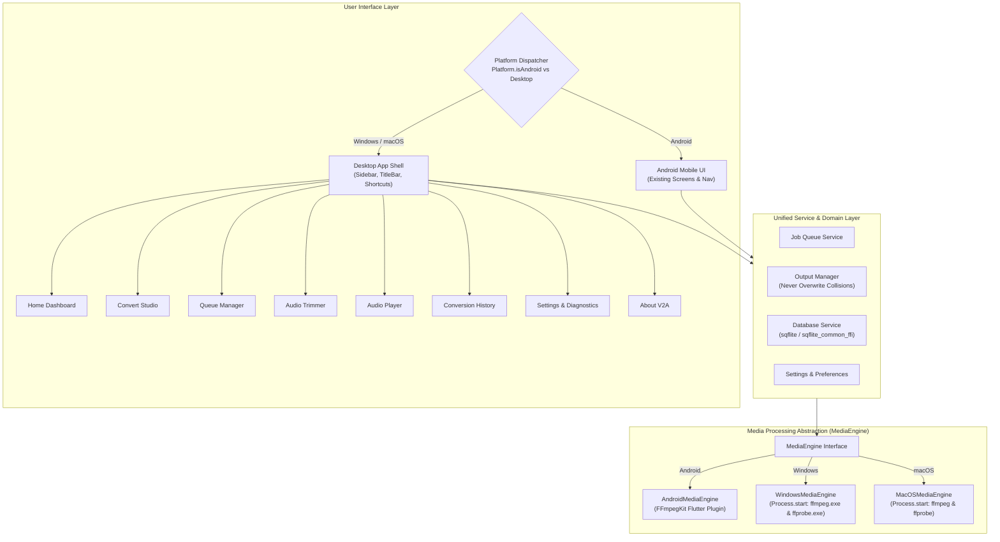

# V2A Desktop v1.2.0 — Architecture & Platform Isolation Specification

## 1. Executive Summary

**V2A Desktop v1.2.0** extends the V2A (Video-to-Audio Converter) project into a native desktop application for **Windows 10/11** and **macOS (Apple Silicon & Intel)**. 

V2A Desktop is built using Flutter Desktop and compiles directly to native machine code (`.exe` on Windows, Mach-O `.app` on macOS). It is **not** an Electron app, web wrapper, PWA, or localhost server.

### Key Identifiers
| Property | Android (Unchanged) | Desktop (Windows / macOS) |
|---|---|---|
| **Application Name** | V2A | V2A |
| **Package / App ID** | `com.v2a.converter.v2a` | `com.v2a.converter.desktop` |
| **Version** | 1.0.0+1 | 1.2.0 |
| **Native Harness** | `android/` (Kotlin, Gradle) | `windows/` (C++ Win32), `macos/` (Cocoa Swift/Obj-C) |
| **Core FFmpeg Engine**| `ffmpeg_kit_flutter_new` (GPL AAR) | Native CLI Process Streaming (`ffmpeg.exe` / `ffprobe.exe`) |

---

## 2. Absolute Android Protection Strategy

The existing Android application represents a verified production-ready mobile product. To guarantee **zero Android regressions**, the following strict isolation protocols are enforced:

1. **Zero Modifications to Android Directory**:
   All 22 tracked files in `android/` (`AndroidManifest.xml`, `build.gradle.kts`, `proguard-rules.pro`, `MainActivity.kt`, drawables, and resources) remain **100% untouched**.
2. **Android Package & Permissions Invariance**:
   The Android package ID remains `com.v2a.converter.v2a` with all existing permissions and Media3 ExoPlayer integration intact.
3. **Android Engine Preservation**:
   Android conversions continue to execute through the existing `ConversionEngine` and `ffmpeg_kit_flutter_new` without changes.
4. **Conditional Service Routing**:
   At app initialization, the runtime checks `Platform.isAndroid`. When running on Android, existing Android UI screens and controllers load natively. On Windows and macOS, the Desktop UI Shell (`DesktopAppShell`) and `DesktopMediaEngine` are activated.
5. **Regression Verification**:
   The Android test suite (`test/final_features_test.dart`, `test/preset_ffmpeg_verification_test.dart`, `test/output_manager_test.dart`) must pass with 100% success after all desktop additions.

---

## 3. Layered Architectural Design



---

## 4. Common Media Engine Interface (`MediaEngine`)

A unified contract abstracts all low-level audio extraction, conversion, trimming, and inspection across platforms:

```dart
abstract class MediaEngine {
  /// Initializes the media engine and locates runtime binaries
  Future<bool> initialize();

  /// Gets the version information of the underlying FFmpeg engine
  Future<String> getVersion();

  /// Probes media file metadata (duration, streams, codecs, sample rate, channels)
  Future<MediaProbeResult> inspectMedia(String filePath);

  /// Executes video-to-audio extraction or audio-to-audio transcoding
  Future<ConversionResult> convertAudio({
    required ConversionJob job,
    required ProgressCallback onProgress,
  });

  /// Trims audio using precise millisecond boundaries
  Future<ConversionResult> trimAudio({
    required String inputPath,
    required String outputPath,
    required int startMs,
    required int endMs,
    ProgressCallback? onProgress,
  });

  /// Cancels an active conversion job
  Future<void> cancelJob(String jobId);

  /// Releases resources
  Future<void> dispose();
}
```

### Desktop Process Engine Details
On Windows and macOS, the engine launches desktop executables via `dart:io` `Process.start`:
- **Progress Monitoring**: Standardized arguments `-progress pipe:1 -nostats` emit key-value progress lines (`out_time_ms=...`, `speed=...`, `total_size=...`) over stdout.
- **Safety**: Command arguments are passed as structured `List<String>` to prevent shell injection, quoting glitches, and path truncation.
- **Streaming**: FFmpeg pipes data without loading multi-gigabyte media files into system RAM.

---

## 5. Desktop UI & Navigation Specification

The Desktop UI adopts native desktop ergonomics with an 8-item sidebar:

| Section | Key Functionality |
|---|---|
| **1. Home** | Quick-start welcome, drag-and-drop media drop zone, system storage stats, FFmpeg readiness banner, instant preset chips. |
| **2. Convert** | Single-file and batch media conversion studio with full preset dropdown (all 8 presets), custom bitrate (16–320 kbps), sample rates, channel modes, volume boost, and EBU R128 loudness normalization. |
| **3. Conversion Queue** | Multi-file background conversion queue with per-job and overall progress, pause/resume, cancel, and auto-recovery. |
| **4. Audio Trimmer** | High-precision waveform visualizer, ±1s, ±5s, ±1m nudge chips, interactive start/end markers, and non-destructive export. |
| **5. Audio Player** | Full offline player supporting MP3, AAC, M4A, WAV, FLAC, OGG, and Opus with playlist queuing, shuffle, repeat, and speed controls (0.5× – 2.0×). |
| **6. Conversion History** | Persistent SQLite conversion records, play output, reveal in File Explorer/Finder, and reconvert actions. |
| **7. Settings** | Default output folder, default preset, audio concurrency, theme toggle (System, Light, Dark), and FFmpeg/FFprobe binary location configuration. |
| **8. About V2A** | Version metadata (v1.2.0 Desktop), system diagnostics, open-source license, and third-party attribution. |

---

## 6. Distribution & Packaging Pipeline

### Windows Packages
1. **EXE Installer** (`V2A-Setup-1.2.0-x64.exe`): Generated via Inno Setup with install wizard, start menu shortcuts, uninstaller, and icon.
2. **MSI Installer** (`V2A-1.2.0-x64.msi`): Standard Windows Installer package for enterprise deployment.
3. **MSIX Package** (`V2A-1.2.0-x64.msix`): Windows 10/11 modern app package with manifest and identity.
4. **Portable ZIP** (`V2A-1.2.0-Portable.zip`): Standalone zero-install archive.

### macOS Packages
1. **App Bundle** (`V2A.app`): Complete signed `.app` bundle with `Info.plist` and icns icon.
2. **DMG Installer** (`V2A-1.2.0-macOS.dmg`): Drag-and-drop installer layout into `/Applications`.
3. **PKG Installer** (`V2A-1.2.0-macOS.pkg`): macOS system installer package.

### Lite vs Complete Modes
- **V2A Lite**: Small download (~15-25 MB). Uses system-installed FFmpeg or prompts user to select `ffmpeg.exe` / `ffmpeg`.
- **V2A Complete**: Standalone download with bundled FFmpeg/FFprobe binaries for instant out-of-the-box offline conversion.

